<div align="center">


<a href="https://github.com/evymelo"></a>


</div>

---

### ♡ sobre mim

```js
const evelyn = {
  role:      ["Software Engineer", "AI Engineer"],
  location:  "Brasil 🇧🇷",
  focus:     ["LLMs", "RAG", "MCP", "design systems"],
  loves:     ["interfaces bonitas", "arquitetura de projetos", "performance"],
  funFact:   "todo código merece um lacinho 🎀",
};
```

---

### ♡ front-end


### ♡ back-end & infra


### ♡ inteligência artificial


---

<div align="center">

### ♡ meu cantinho no github

<table>
<tr>
<td width="50%"></td>
<td width="50%"></td>
</tr>
<tr>
<td width="50%"></td>
<td width="50%"></td>
</tr>
</table>

<picture>
  <source media="(prefers-color-scheme: dark)" srcset="https://raw.githubusercontent.com/evymelo/evymelo/output/snake-dark.svg"/>
  
</picture>

---

### ♡ vamos conversar?

[](https://portfolio-evelyn-melo.vercel.app/)
[](https://linkedin.com/in/evelyn-m-430880275)
[](mailto:evyszf@gmail.com)


</div>
